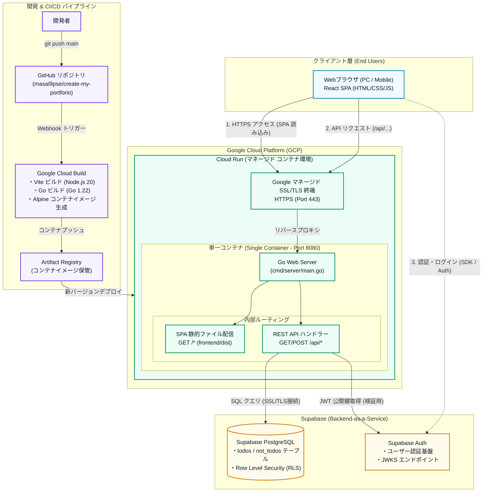

# My Portfolio

---

## 1. インフラ構成図 (Infrastructure Architecture)

本アプリケーションは、**Google Cloud Run (単一コンテナ配信)** と **Supabase (PostgreSQL / Auth)** を組み合わせ、個人開発・ポートフォリオとして **月額 0 円（完全無料枠内）** での安定稼働とシンプルな保守性を両立したインフラ構成を採用しています。



> [!NOTE]
> インフラの設計意図、セキュリティ、各コンポーネントの選定理由の詳細については [docs/infrastructure.md](file:///Users/yamamotohiroto/dev_workspace/my-portforio/docs/infrastructure.md) をご覧ください。

---

## 2. 技術スタック (Tech Stack)

| レイヤー | 技術 / ツール | 役割・選定理由 |
| :--- | :--- | :--- |
| **Frontend** | React 18, TypeScript, Vite, Tailwind CSS, Lucide React | 高速な SPA 開発、型安全性、モダンな UI 構築 |
| **Backend** | Go 1.22 (`net/http`, `lib/pq`) | 軽量・高速な実行バイナリ、単一コンテナでの SPA & API 同居配信 |
| **Database** | PostgreSQL (Supabase) | リレーショナルデータ永続化、Row Level Security (RLS) |
| **Authentication** | Supabase Auth (JWT / JWKS) | メール認証、セッション管理、Go 側での JWKS 公開鍵検証 |
| **Hosting & Infra** | Google Cloud Run (Serverless Container) | ゼロスケール、マネージド HTTPS、月 200 万 req 無料枠 |
| **CI/CD** | Google Cloud Build, Artifact Registry | GitHub Push 連動マルチステージ Docker ビルド & 自動デプロイ |
| **Container** | Docker (Multi-stage build / Alpine Linux) | 最小サイズ（数十MB）の軽量プロダクションイメージ |

---

## 3. ドキュメント一覧

- [インフラ構成仕様書 (docs/infrastructure.md)](file:///Users/yamamotohiroto/dev_workspace/my-portforio/docs/infrastructure.md): インフラ全体図、ネットワーク・セキュリティ、CI/CD詳細
- [システム構成仕様書 (ARCHITECTURE.md)](file:///Users/yamamotohiroto/dev_workspace/my-portforio/ARCHITECTURE.md): バックエンドレイヤー構造、データフロー、トレードオフ評価
- [アーキテクチャ意思決定記録 (docs/adr/0001-serve-frontend-from-go-backend.md)](file:///Users/yamamotohiroto/dev_workspace/my-portforio/docs/adr/0001-serve-frontend-from-go-backend.md): フロントエンド同居配信の採用理由
- [プロダクト仕様書 (SPEC.md)](file:///Users/yamamotohiroto/dev_workspace/my-portforio/SPEC.md): StrandLog のプロダクト機能仕様・要件
- [開発運用ポリシー (DEVELOPMENT_POLICY.md)](file:///Users/yamamotohiroto/dev_workspace/my-portforio/DEVELOPMENT_POLICY.md): 開発ルール・ブランチ運用

---

## 4. ローカル開発環境のセットアップ

### 前提条件
- Node.js 20+
- Go 1.22+
- Docker (オプション)

### 起動手順

1. **環境変数の準備**:
   ```bash
   cp .env.example .env
   # .env 内に Supabase の接続情報を設定
   ```

2. **フロントエンド起動**:
   ```bash
   cd frontend
   npm install
   npm run dev
   ```

3. **バックエンド起動**:
   ```bash
   cd backend
   go run ./cmd/server
   ```