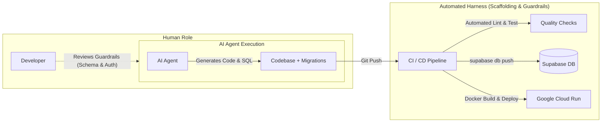

# AI Harness Strategy (AI-Driven Engineering & Delivery Harness)

This document outlines the **Harness Strategy** for **StrandLog (My Portfolio)**. It defines the automated scaffolding, CI/CD pipelines, and safety guardrails required to support high-velocity, autonomous, AI-driven development (Hybrid Vibe Coding) without human bottlenecks.

---

## 1. Overview & Problem Statement

### The Problem: AI Velocity Throttled by Manual Friction
In AI-assisted and agentic development, the AI agent can generate features, fix bugs, and refactor code in seconds. However, the development feedback loop breaks down when infrastructure tasks require manual human intervention:
- **Database Migrations**: Manually opening the Supabase Web Console, copy-pasting SQL into the SQL Editor, and executing it.
- **Deployments**: Manually running `gcloud run deploy` commands or triggering builds via the GCP Console.
- **Verification Delays**: Long build/deploy waiting times before verifying changes, causing cognitive switching and breaking development momentum.

### The Solution: An Engineering Harness
An **AI Harness** acts as the automated structural boundary around the AI agent. It automates repetitive operational tasks (testing, migration, deployment) while enforcing non-negotiable safety guardrails (type checking, idempotent migrations, secret management).

---

## 2. Core Pillars of the Harness Strategy

### Pillar 1: Automated Database Harness (Continuous Migration)
To eliminate manual SQL copy-pasting into web dashboards, database migrations are treated strictly as version-controlled code.

* **Schema-as-Code**: All database changes are defined as idempotent SQL files in `database/migrations/` (e.g., `003_add_feature_x.sql`).
* **Automated CI Push**:
  * Using **Supabase CLI** inside GitHub Actions (`supabase db push`).
  * On merge to `main`, the CI runner connects securely to Supabase using secrets (`SUPABASE_ACCESS_TOKEN`, `SUPABASE_PROJECT_ID`, `SUPABASE_DB_PASSWORD`) and applies unapplied migrations automatically.
* **Human-in-the-Loop Guardrail**:
  * Humans review database schema and relational integrity during PR review (per [DEVELOPMENT_POLICY.md](file:///Users/yamamotohiroto/dev_workspace/my-portforio/DEVELOPMENT_POLICY.md)), but do not execute them manually.

### Pillar 2: Automated Deployment Harness (Continuous Delivery to Cloud Run)
Deployment to Cloud Run must be automated and declarative, ensuring consistent builds across frontend and backend.

* **Single-Container Multi-Stage Pipeline**:
  * Dockerfile coordinates Vite production build (Node.js) and Go static binary compilation.
* **Automatic Cloud Run Rollout**:
  * Merges to `main` automatically trigger image builds (via Google Cloud Build or GitHub Actions with Workload Identity Federation).
  * Automated deployment to Cloud Run with zero downtime and automatic traffic redirection to the newest revision.
* **Build-Time vs. Runtime Env Variable Validation**:
  * The harness enforces that frontend client variables (`VITE_SUPABASE_URL`, `VITE_SUPABASE_ANON_KEY`) are passed during the container build step, while Go server secrets (`SUPABASE_DB_URL`, `SUPABASE_JWKS_URL`) are injected into Cloud Run at runtime.

### Pillar 3: Fast Feedback & Verification Harness
Deploying to Cloud Run can take several minutes. To maintain high AI throughput, the harness supports a tiered verification model:

1. **Tier 1 (Instant Local Checks - seconds)**:
   - Go compiler check (`go build ./...`)
   - TypeScript type checks (`npm run build` or `tsc --noEmit`)
   - Pre-commit linters / unit tests
   - AI agents run these directly in the local sandbox before proposing commits.
2. **Tier 2 (Local Integration Test - optional)**:
   - Local container execution or Supabase CLI local mock when modifying complex relational queries or auth middleware.
3. **Tier 3 (Automated Production Deployment - minutes)**:
   - Full automated deployment to Cloud Run and production Supabase via CI/CD upon push.

---

## 3. Workflow Comparison: Before vs. After Harness

| Step | Before (Manual Bottleneck) | With AI Harness (Autonomous & Safe) |
| :--- | :--- | :--- |
| **Code Generation** | AI writes code & SQL | AI writes code & SQL |
| **Database Migration** | ❌ Human opens Supabase dashboard, copies SQL, clicks Run | ✅ CI automatically runs `supabase db push` on merge |
| **Build & Deploy** | ❌ Human runs `gcloud run deploy` or triggers GCP Console | ✅ CI automatically builds Docker image and deploys to Cloud Run |
| **Verification** | ❌ Human verifies deployment status and checks logs manually | ✅ Automated health check ping (`/api/todos`) confirms revision health |
| **Human Focus** | High cognitive load on repetitive ops | Pure focus on system architecture, design decisions, and PR review |

---

## 4. Implementation Roadmap

### Phase 1: Database Migration Pipeline (Priority 1)
- [ ] Store Supabase deployment credentials in GitHub Repository Secrets:
  - `SUPABASE_ACCESS_TOKEN`
  - `SUPABASE_PROJECT_ID`
  - `SUPABASE_DB_PASSWORD`
- [ ] Create `.github/workflows/db-migrate.yml` using `supabase/setup-cli` and `supabase db push`.
- [ ] Verify automated migration execution on branch push.

### Phase 2: Cloud Run Continuous Delivery (Priority 2)
- [ ] Configure GitHub Actions workflow or Cloud Build GitHub App trigger for repository `masal9pse/create-my-portforio`.
- [ ] Set up GCP Workload Identity Federation or Service Account credentials for secure container builds and Cloud Run deployment.
- [ ] Automate zero-downtime revision switches and rollback on health-check failure.

### Phase 3: AI Agent Scaffolding & Slash Commands (Priority 3)
- [ ] Standardize agent instructions (`AGENTS.md` / `.cursorrules`) to guide AI on:
  - Adding migration scripts with idempotency (`CREATE TABLE IF NOT EXISTS`, etc.).
  - Running fast local syntax/type validation before concluding tasks.
- [ ] Integrate automated health checks to verify live deployments.
