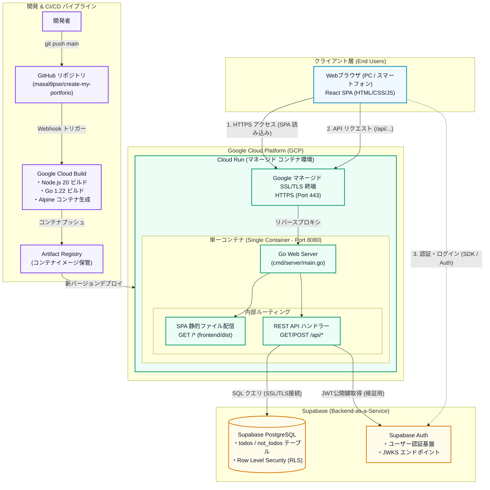

# インフラ構成仕様書 (Infrastructure Architecture)

本ドキュメントは、**StrandLog (My Portfolio)** のクラウドインフラ環境、ネットワーク構成、CI/CD パイプライン、およびセキュリティ設計についてまとめたものです。

---

## 1. インフラ全体構成図 (Infrastructure Diagram)

本システムは、**Google Cloud Platform (GCP)** と **Supabase (BaaS)** を組み合わせ、完全無料枠内（0円運用）で高可用性とシンプルな運用保守性を実現するインフラアーキテクチャを採用しています。

---

## 2. 各インフラコンポーネントの責務と選定理由

### 2.1 Google Cloud Run (実行環境)
* **概要**: Google Cloud 上のフルマネージド・サーバーレスコンテナ実行環境。
* **選定理由**:
  * **0円運用 (無料枠)**: 月間 200 万リクエスト、360,000 GB 秒のメモリ、180,000 vCPU 秒が完全無料で利用可能。
  * **ゼロスケール (Scale-to-Zero)**: アクセスがない時間帯はインスタンス数が自動で 0 に縮小し、余計なリソース・コストを一切消費しません。
  * **自動 HTTPS / ドメイン管理**: Google がマネージド SSL/TLS 証明書を自動発行・更新し、HTTPS エンドポイントを提供。
  * **単一コンテナ配信アーキテクチャ**:
    * フロントエンド（React ビルド成果物）とバックエンド（Go API）を 1 つの Docker イメージにパッケージング。
    * 同一オリジン（ポート 8080）から配信することで、**CORS エラーを根絶**し、インフラ構成を最小化しています。

### 2.2 Google Cloud Build & Artifact Registry (CI/CD パイプライン)
* **概要**: GitHub のリポジトリと連携した自動ビルド＆自動デプロイ環境。
* **ビルドフロー**:
  1. `main` ブランチへの `git push` を検知。
  2. マルチステージビルド（`Dockerfile`）を実行:
     - **Stage 1 (Node.js 20)**: `frontend/` 配下の依存関係インストールおよび Vite ビルド (`dist/` 生成)。
     - **Stage 2 (Go 1.22)**: `backend/` 配下の Go ソースコードを Linux 用静的バイナリにコンパイル。
     - **Stage 3 (Alpine Linux)**: 最小限の Alpine イメージに Go バイナリと `dist/` 静的ファイルのみをコピー。
  3. ビルドされたイメージを Artifact Registry に格納。
  4. Cloud Run サービスへ新リビジョンとしてローリングデプロイ。
* **無料枠**: 月間 2,500 ビルド分が無料。

### 2.3 Supabase (PostgreSQL / Auth)
* **概要**: オープンソースの Firebase 代替 BaaS プラットフォーム。
* **選定理由**:
  * **マネージド PostgreSQL**: リレーショナルデータベースの運用管理、バックアップ、SSL接続が完備。
  * **Supabase Auth**: JWT (JSON Web Token) ベースのセキュアな認証基盤を提供。
  * **無料枠**: データベース 500MB、月間 50,000 MAU (月間アクティブユーザー) まで完全無料。
  * **認証検証フロー**:
    * クライアントは Supabase Auth と直接通信してログイン / トークン取得。
    * Go API サーバーは Supabase の JWKS (JSON Web Key Set) エンドポイントから公開鍵を取得し、リクエストヘッダーの JWT を検証。

---

## 3. ネットワークとセキュリティ

| 項目 | 実装方針 |
| :--- | :--- |
| **通信暗号化 (In-Transit)** | 全ての通信（クライアント ⇔ Cloud Run、Cloud Run ⇔ Supabase）を HTTPS / TLS 1.3 で暗号化。 |
| **CORS (Cross-Origin Resource Sharing)** | 単一コンテナによる同一オリジン配信のため、本番環境での CORS 制約が発生しない安全な構成。 |
| **環境変数・シークレット管理** | `DATABASE_URL`, `SUPABASE_URL`, `SUPABASE_KEY` などの機密情報は Cloud Run の環境変数 / Secret Manager で注入。コードベースには一切含めない。 |
| **アクセス制御 (DB)** | PostgreSQL 上で Row Level Security (RLS) を有効化し、ユーザー単位でのデータ分離を保証。 |

---

## 4. 将来的なスケーリング方針 (段階的移行)

アクセス急増やフロントエンドの独立デプロイ（高速化）が必要になった場合、以下のステップでインフラを拡張可能です。

1. **フロントエンドの分離 (Edge CDN)**:
   - React SPA を **Vercel** または **Cloudflare Pages** へ切り離し、世界規模のエッジ CDN から 30 秒で即時デプロイ。
2. **Cloud Run の最小インスタンス設定 (Min Instances = 1)**:
   - コールドスタート（インスタンス起動待ち）のレイテンシを完全に解消。
3. **Cloudflare CDN / Cloud Armor の導入**:
   - Cloud Run の前段に CDN キャッシュと WAF / DDoS 対策レイヤーを追加。
